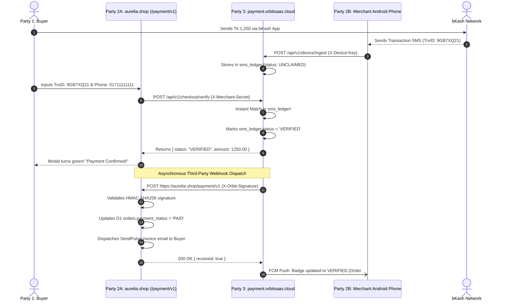
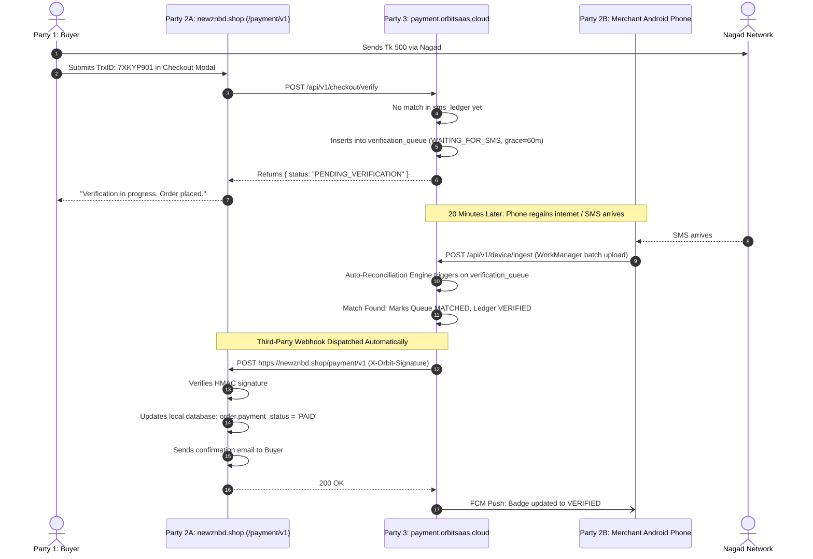

# ORBIT Payment Hub — System Architecture Specification

> **Part of ORBIT Context Directory** | [Back to Master Context](file:///c:/Users/Adnan/Desktop/OrbitSaaS/Orbit%20Payment/context/context.md)

---

## 📌 Document Metadata & Activity Tracker

| Field | Value |
|---|---|
| **Document** | System Architecture & Network Topology |
| **Status** | Active / Production Specification |
| **Last Updated** | 2026-11-25 19:50:00 +06:00 |
| **Last Prompt / Trigger** | Self-Hosted Free Cloudflare Durable Objects WebSocket Push Hub, 3-Tier Push Fallback & Email OTP Fallback (`/spin-subagents`) |
| **Actions Taken** | Added SQLite-backed Durable Object `MerchantPushHub` (`PUSH_HUB`) with WebSocket Hibernation + `"ping"`/`"pong"` auto-response, `GET /api/v1/device/ws` with Hono CORS bypass, 3-tier push chain (Self-Hosted DO WebSocket → Optional FCM v1 → Adaptive 60s/300s `/sync` polling), Android OkHttp `PushWebSocketClient`, and `routeEmail` OTP fallback. |

---

## 1. System Topology Overview

ORBIT Payment Hub operates as an Edge-native Cloudflare architecture connecting three distinct parties:

```
[Party 1: Visitor / Buyer]
       │
       │ 1. Submits TrxID + Sender Phone in Checkout Modal
       ▼
[Party 2A: Third-Party Client Storefronts]
 ├── ecom.orbitsaas.cloud
 ├── aurelia.shop (Callback: /payment/v1)
 └── newznbd.shop (Callback: /payment/v1)
       │
       │ 2. POST /api/v1/checkout/verify (X-Merchant-Secret)
       ▼
[Party 3: ORBIT Central Hub (payment.orbitsaas.cloud)]
(Single Cloudflare Worker + Static Assets: backend/src/worker.ts + Hono + D1 + Cron)
       │
       │ 3. Dispatches HMAC Signed Webhook (X-Orbit-Signature)
       │    e.g. POST https://aurelia.shop/payment/v1
       ▼
[Client Store Backend Marks Order PAID & Dispatches Invoice]
       ▲
       │ 4. Ingests SMS / Push (X-Device-Key)
[Party 2B: Merchant Android Companion App]
(Native Kotlin + Room DB + WorkManager on Merchant Phone)
```

---

## 2. Multi-Storefront Third-Party API Architecture

ORBIT SaaS supports any number of custom client websites via dynamic webhook callbacks.

### 2.1 The Third-Party Storefront Callback Contract
When an MFS payment is verified, `payment.orbitsaas.cloud` makes an outgoing HTTP POST request to the merchant's registered third-party API endpoint.

#### Supported Client Endpoint Examples:
* `POST https://ecom.orbitsaas.cloud/api/v1/webhooks/orbit-payment`
* `POST https://aurelia.shop/payment/v1`
* `POST https://newznbd.shop/payment/v1`

#### Webhook Request Headers:
```http
POST /payment/v1 HTTP/1.1
Host: aurelia.shop
Content-Type: application/json
User-Agent: OrbitPaymentEngine/1.0
X-Orbit-Signature: f9a87c6e5d4c3b2a1... (HMAC-SHA256 hex)
X-Orbit-Event-Id: evt_live_891247192
X-Orbit-Delivery-Attempt: 1
```

#### Webhook JSON Payload Schema:
```json
{
  "event": "payment.verified",
  "eventId": "evt_live_891247192",
  "timestamp": 1731932400000,
  "data": {
    "merchantId": "mer_aurelia_01",
    "externalOrderId": "ORDER-90214",
    "provider": "BKASH",
    "accountType": "PERSONAL",
    "trxId": "9GB7XQ21",
    "amount": 1250.00,
    "senderNumber": "01711111111",
    "receiverWallet": "01712345678",
    "status": "VERIFIED",
    "verifiedAt": 1731932400000
  }
}
```

---

## 3. End-to-End Sequence Diagrams

### 3.1 Instant Verification (SMS Arrived Prior to / During Checkout)



---

### 3.2 Deferred Reconciliation (Merchant Offline / Operator SMS Lag)



---

## 4. Cryptographic Security & Third-Party Storefront Integration

### 4.1 Client-Side Webhook Verification (Node.js / Cloudflare Workers / Hono)
Every custom e-commerce store (e.g., `aurelia.shop`, `newznbd.shop`) uses this standard verification middleware to validate requests from `payment.orbitsaas.cloud`:

```typescript
import { Context, Next } from 'hono';

export async function verifyOrbitWebhook(c: Context, next: Next) {
  const signature = c.req.header('x-orbit-signature');
  const rawBody = await c.req.text();
  const secret = c.env.ORBIT_WEBHOOK_SECRET;

  if (!signature) {
    return c.json({ error: 'Missing X-Orbit-Signature header' }, 401);
  }

  const encoder = new TextEncoder();
  const key = await crypto.subtle.importKey(
    'raw',
    encoder.encode(secret),
    { name: 'HMAC', hash: 'SHA-256' },
    false,
    ['verify']
  );

  const isValid = await crypto.subtle.verify(
    'HMAC',
    key,
    hexToUint8Array(signature),
    encoder.encode(rawBody)
  );

  if (!isValid) {
    return c.json({ error: 'Invalid HMAC signature' }, 401);
  }

  c.set('orbitPayload', JSON.parse(rawBody));
  await next();
}

function hexToUint8Array(hex: string): Uint8Array {
  const match = hex.match(/.{1,2}/g) || [];
  return new Uint8Array(match.map((byte) => parseInt(byte, 16)));
}
```

---

## 5. Failure Modes & Self-Healing Matrix

| Failure Mode | Root Cause | Self-Healing Mechanism |
| :--- | :--- | :--- |
| **Merchant Phone Offline** | Battery dead, traveling, no 4G signal. | Orders queue in `verification_queue` for up to 60 minutes. The instant the phone powers on, `WorkManager` batch-uploads all SMS, triggering auto-reconciliation and instant webhook delivery. |
| **Third-Party Storefront Down** | `aurelia.shop` server cold start or 502 error. | Central Hub logs failure in `webhook_deliveries` and schedules exponential backoff retries (1m, 5m, 15m, 1h, 24h). |
| **Customer TrxID Typo** | Buyer enters `0` instead of `O` or misses a digit. | Transaction is preserved in `sms_ledger` as `UNCLAIMED`. Merchant opens the "Typo Rescue" modal on `payment.orbitsaas.cloud/dashboard` and binds the SMS to the order with 1 click. |
| **Double-Spend Replay** | Attacker attempts to reuse a valid TrxID on a second order. | Database constraint `UNIQUE (merchant_id, trx_id)` rejects duplicate claims. Ledger status moves to `VERIFIED` and cannot be claimed again. |

---

## 6. Unified Service Router Architecture (`router/`)

To guarantee **zero secret leakage** and **zero provider lock-in**, all external infrastructure providers are isolated behind a dedicated `router/` abstraction layer:

* **Frontend Client Proxy (`frontend/src/router/`):** Exposes `email.ts`, `image.ts`, `sms.ts`, `database.ts`, and `index.ts`. Frontend code never imports provider SDKs or reads any secret keys; it only calls `/api/v1/router/*`.
* **Backend Verification Gate (`backend/src/router/router.routes.ts`):** Every `/api/v1/router/*` mutation endpoint authenticates the caller first (`X-Merchant-Secret`, `Authorization: Bearer`, `X-Device-Key`, or `X-Admin-Key`) and validates payloads with Zod before dispatching.
* **Intelligent Secret & Failover Engine (`backend/src/router/secrets.ts`):** Reads Cloudflare Worker secrets/bindings strictly on the backend, detects quota/rate-limit exhaustion (`402`, `429`, quota errors), applies per-isolate cooldown circuit-breaking, automatically fails over to the next configured provider, and persists failover audit trails to D1 `router_provider_logs`.

### 6.1 Provider Fallback Chains

| Router File | Channel | Automatic Fallback Priority (Configurable via `*_PROVIDER_ORDER`) |
| :--- | :--- | :--- |
| `backend/src/router/email.ts` | Email | `resend` → `brevo` → `sendpulse` → `aws_ses` (SigV4) → `sendgrid` → `cloudflare` → `apps_script` → `custom_webhook` |
| `backend/src/router/image.ts` | Image Upload & Download | `r2` → `imgbb` → `supabase` → `mongodb` → `d1` (built-in `media_assets` blob fallback) |
| `backend/src/router/sms.ts` | SMS & Push | SMS: `bulksmsbd` → `ssl_wireless` → `twilio` → `custom_webhook` \| Push: `MerchantPushHub` (DO WebSocket via `router/push-hub.ts`) → `fcm` (optional HTTP v1 via `router/fcm.ts`) → `custom_webhook` |
| `backend/src/router/database.ts` | Database & KV | `kv` → `d1` (`router_kv_store`) → `supabase` → `mongodb` → `turso` |

---

## 7. Anti-Spoofing Trust Model, 3-Tier Self-Hosted Push Hub & OTP Flow

### 7.1 SMS & Push Anti-Spoofing Trust Model
* **Phone Primary Anchor (`SenderTrust.kt` & `MfsParser.kt`):** Only accepts SMS whose originating address matches the provider's official sender list (`BKASH: ["bKash"]`, `NAGAD: ["NAGAD"]`, `ROCKET: ["16216", "Rocket"]`, `UPAY: ["upay"]`, `CELLFIN: ["CellFin", "IBBL"]` + user-configured `extraTrustedSenders`) or exact app package IDs (`PushListener.kt`). Personal phone numbers (`^\+?(88)?01\d{9}$`) and mismatched provider/sender pairs are rejected and logged locally in Room `blocked_messages`.
* **Server Defense-in-Depth (`backend/src/shared/sms-trust.ts`):** `evaluateSmsTrust(msg)` checks in order: missing `smsSender` (`LEGACY_UNVERIFIED_SENDER`), personal phone or untrusted notification package (`UNTRUSTED_SENDER`), and server re-parse / TrxID / amount mismatch (`PARSE_MISMATCH`). Flagged rows are stored in `sms_ledger` as `UNCLAIMED` with `trust_flag`, excluded from auto-reconciliation and `verifyCheckoutPayment`, and broadcast via `SMS_FLAGGED`.
* **Inbox Rescan (`InboxScanner.kt`):** Reads `Telephony.Sms.Inbox.CONTENT_URI` on login, `SyncWorker` runs, and manual Diagnostics triggers (default 72h lookback) using `source = 'INBOX_SCAN'` through the same trust pipeline.

### 7.2 3-Tier Self-Hosted Push Hub (Zero-Firebase Instant Alerts)
* **Tier 1 — Cloudflare Durable Objects WebSocket (`backend/src/durable/merchant-push-hub.ts` & `router/push-hub.ts`):** Uses SQLite-backed `MerchantPushHub` (`PUSH_HUB` binding, `new_sqlite_classes`) with WebSocket Hibernation (`acceptWebSocket`, `setWebSocketAutoResponse(new WebSocketRequestResponsePair('ping', 'pong'))`) on the Cloudflare Free plan (`$0`). `GET /api/v1/device/ws` authenticates via `authDeviceMiddleware`, bypasses Hono CORS header mutation on `Upgrade: websocket`, and streams instant `<1s` JSON push frames (`payment.verified`, `order.created`, `order.action_required`, `ADMIN_TEST_PUSH`) to `PushWebSocketClient.kt` (OkHttp 45s keepalive + exponential backoff).
* **Tier 2 — Optional FCM HTTP v1 (`backend/src/router/fcm.ts`):** If `FCM_SERVICE_ACCOUNT_JSON` + `google-services.json` are configured, `sendPushToMerchantDevicesDetailed` also dispatches data-only `HIGH` priority FCM v1 pushes (Web Crypto RS256 PKCS#8 JWT signing + cached OAuth2 token) and nulls out `UNREGISTERED` tokens.
* **Tier 3 — Adaptive Sync Polling Fallback (`StickyForegroundService.kt`):** Polls `GET /api/v1/device/sync?since=...` every **60s** when WebSocket is not `CONNECTED` and Firebase is absent, relaxes to **300s** when WebSocket is `CONNECTED` or Firebase is active, triggers an immediate catch-up `/sync` upon WebSocket connect, and deduplicates order alerts via `PreferencesManager.markOrderSeen`.

### 7.3 Storefront OTP Flow & Email Fallback (`backend/src/features/otp/`)
* Protected by `authMerchantMiddleware` (`POST /api/v1/otp/send` and `POST /api/v1/otp/verify`).
* Generates CSPRNG 6-digit OTPs (`crypto.getRandomValues`), hashes with `HMAC-SHA256(code, pepper + phone + id)` in `otp_codes` (5m TTL), enforces 60s resend cooldown and 5 sends/hour, and locks after 5 failed attempts.
* **Delivery Failover:** Attempts SMS via `routeSmsOrPush`; if SMS fails or is unconfigured and optional `email` is supplied, falls back automatically to `routeEmail` (`channel: 'EMAIL'`, `provider: 'email:<provider>'`); falls back to `devCode` (`channel: 'DEV'`) only in non-production when no gateway succeeds.
