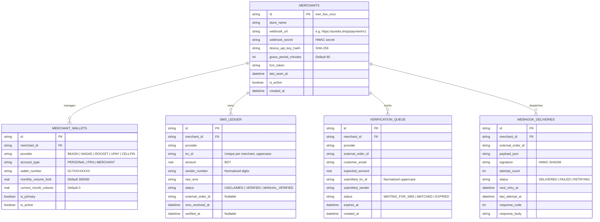

# ORBIT Payment Hub — Database Architecture & Schema Specification

> **Part of ORBIT Context Directory** | [Back to Master Context](file:///c:/Users/Adnan/Desktop/OrbitSaaS/Orbit%20Payment/context/context.md)

---

## 📌 Document Metadata & Activity Tracker

| Field | Value |
|---|---|
| **Document** | Database Schemas, Entities, Indexes & Data Dictionary |
| **Status** | Active / Production Specification |
| **Last Updated** | 2026-11-23 00:05:00 +06:00 |
| **Last Prompt / Trigger** | Unique positive 2-decimal poisha checkout, admin-provisioned JWT/Session auth, and bi-directional e-commerce order sync |
| **Actions Taken** | Added `checkout_sessions`, `merchant_users`, `auth_sessions`, `merchant_devices`, and `merchant_orders` tables plus `sms_ledger.match_type` and `verification_queue.{base_amount,unique_amount,submitted_amount}` columns (`backend/drizzle/0002_auth_unique_orders.sql`). |

---

## 1. Central Hub Edge Database (`backend/src/db/schema.ts`)

Powered by **Cloudflare D1** (Serverless SQLite at the V8 Edge) managed with **Drizzle ORM**.



---

## 2. Complete Drizzle ORM Schema (`backend/src/db/schema.ts`)

```typescript
import { sqliteTable, text, integer, real, uniqueIndex, index } from "drizzle-orm/sqlite-core";

// 1. Merchants Table
export const merchants = sqliteTable("merchants", {
  id: text("id").primaryKey(), // mer_live_xxxx
  storeName: text("store_name").notNull(),
  webhookUrl: text("webhook_url").notNull(), // Third-party endpoint (e.g. https://aurelia.shop/payment/v1)
  webhookSecret: text("webhook_secret").notNull(), // Used for HMAC-SHA256 signature
  deviceApiKeyHash: text("device_api_key_hash").notNull(), // SHA-256 of the mobile device key
  gracePeriodMinutes: integer("grace_period_minutes").notNull().default(60),
  fcmToken: text("fcm_token"),
  lastSeenAt: integer("last_seen_at", { mode: "timestamp" }),
  isActive: integer("is_active", { mode: "boolean" }).notNull().default(true),
  createdAt: integer("created_at", { mode: "timestamp" }).$defaultFn(() => new Date()),
});

// 2. Merchant Wallets (Multi-SIM Pooling & Limit Rotation)
export const merchantWallets = sqliteTable("merchant_wallets", {
  id: text("id").primaryKey(),
  merchantId: text("merchant_id").notNull().references(() => merchants.id),
  provider: text("provider", { enum: ["BKASH", "NAGAD", "ROCKET", "UPAY", "CELLFIN"] }).notNull(),
  accountType: text("account_type", { enum: ["PERSONAL", "PRA", "MERCHANT"] }).default("PERSONAL").notNull(),
  walletNumber: text("wallet_number").notNull(),
  monthlyVolumeLimit: real("monthly_volume_limit").default(300000).notNull(),
  currentMonthVolume: real("current_month_volume").default(0).notNull(),
  isPrimary: integer("is_primary", { mode: "boolean" }).default(false).notNull(),
  isActive: integer("is_active", { mode: "boolean" }).default(true).notNull(),
}, (table) => ({
  walletLookupIdx: index("idx_wallets_lookup").on(table.merchantId, table.provider, table.isActive),
}));

// 3. SMS Ledger Table
export const smsLedger = sqliteTable("sms_ledger", {
  id: text("id").primaryKey(),
  merchantId: text("merchant_id").notNull().references(() => merchants.id),
  provider: text("provider", { enum: ["BKASH", "NAGAD", "ROCKET", "UPAY", "CELLFIN"] }).notNull(),
  trxId: text("trx_id").notNull(), // Normalized uppercase
  amount: real("amount").notNull(),
  senderNumber: text("sender_number").notNull(), // Normalized (no +88)
  rawSms: text("raw_sms").notNull(),
  status: text("status", { enum: ["UNCLAIMED", "VERIFIED", "MANUAL_VERIFIED"] }).default("UNCLAIMED").notNull(),
  externalOrderId: text("external_order_id"),
  smsReceivedAt: integer("sms_received_at", { mode: "timestamp" }).notNull(),
  verifiedAt: integer("verified_at", { mode: "timestamp" }),
}, (table) => ({
  uniqueMerchantTrx: uniqueIndex("unique_merchant_trx").on(table.merchantId, table.trxId),
  statusLookupIdx: index("idx_ledger_status").on(table.merchantId, table.status),
}));

// 4. Verification Queue Table
export const verificationQueue = sqliteTable("verification_queue", {
  id: text("id").primaryKey(),
  merchantId: text("merchant_id").notNull().references(() => merchants.id),
  provider: text("provider", { enum: ["BKASH", "NAGAD", "ROCKET", "UPAY", "CELLFIN"] }).notNull(),
  externalOrderId: text("external_order_id").notNull(),
  customerEmail: text("customer_email").notNull(),
  expectedAmount: real("expected_amount").notNull(),
  submittedTrxId: text("submitted_trx_id").notNull(), // Normalized uppercase
  submittedSender: text("submitted_sender").notNull(), // Normalized digits
  status: text("status", { enum: ["WAITING_FOR_SMS", "MATCHED", "EXPIRED"] }).default("WAITING_FOR_SMS").notNull(),
  expiresAt: integer("expires_at", { mode: "timestamp" }).notNull(),
  createdAt: integer("created_at", { mode: "timestamp" }).notNull(),
}, (table) => ({
  queueLookupIdx: index("idx_queue_lookup").on(table.merchantId, table.submittedTrxId, table.status),
}));

// 5. Webhook Deliveries Table (Retry Engine)
export const webhookDeliveries = sqliteTable("webhook_deliveries", {
  id: text("id").primaryKey(),
  merchantId: text("merchant_id").notNull().references(() => merchants.id),
  externalOrderId: text("external_order_id").notNull(),
  payloadJson: text("payload_json").notNull(),
  signature: text("signature").notNull(),
  attemptCount: integer("attempt_count").default(1).notNull(),
  status: text("status", { enum: ["DELIVERED", "FAILED", "RETRYING"] }).default("RETRYING").notNull(),
  nextRetryAt: integer("next_retry_at", { mode: "timestamp" }),
  lastAttemptAt: integer("last_attempt_at", { mode: "timestamp" }),
  responseCode: integer("response_code"),
  responseBody: text("response_body"),
});
// 6. Media Assets Registry (Unified Image Router Metadata + D1 Blob Fallback)
export const mediaAssets = sqliteTable("media_assets", {
  id: text("id").primaryKey(),
  merchantId: text("merchant_id"),
  fileName: text("file_name").notNull(),
  mimeType: text("mime_type").notNull(),
  sizeBytes: integer("size_bytes").notNull(),
  sha256: text("sha256").notNull(),
  primaryProvider: text("primary_provider").notNull(), // r2 | imgbb | supabase | mongodb | d1
  storageKey: text("storage_key").notNull(),
  publicUrl: text("public_url"),
  fallbackLocationsJson: text("fallback_locations_json"),
  dataBase64: text("data_base64"),
  createdAt: integer("created_at", { mode: "timestamp" }).notNull(),
});

// 7. Router Key-Value Store (D1 Fallback for Cloudflare KV)
export const routerKvStore = sqliteTable("router_kv_store", {
  key: text("key").primaryKey(),
  valueJson: text("value_json").notNull(),
  expiresAt: integer("expires_at", { mode: "timestamp" }),
  updatedAt: integer("updated_at", { mode: "timestamp" }).notNull(),
});

// 8. Router Provider Audit Logs (Tracks automatic fallbacks)
export const routerProviderLogs = sqliteTable("router_provider_logs", {
  id: text("id").primaryKey(),
  channel: text("channel").notNull(), // email | sms | image | database
  selectedProvider: text("selected_provider"),
  status: text("status").notNull(), // SUCCESS | FALLBACK_SUCCESS | FAILED
  fallbackTriggered: integer("fallback_triggered", { mode: "boolean" }).default(false).notNull(),
  attemptsJson: text("attempts_json").notNull(),
  latencyMs: integer("latency_ms").notNull(),
  callerId: text("caller_id"),
  createdAt: integer("created_at", { mode: "timestamp" }).notNull(),
});
```

---

## 3. Companion Android Local Database (`app/data/local/`)

Powered by **Android Jetpack Room DB** (SQLite):

```kotlin
// app/data/local/SmsEntity.kt
package com.orbitsaas.payment.data.local

import androidx.room.Entity
import androidx.room.Index
import androidx.room.PrimaryKey

@Entity(
    tableName = "local_sms",
    indices = [Index(value = ["trxId"], unique = true)]
)
data class SmsEntity(
    @PrimaryKey val id: String,
    val provider: String, // "BKASH", "NAGAD", "ROCKET", "UPAY", "CELLFIN"
    val trxId: String,
    val amount: Double,
    val senderNumber: String,
    val rawSms: String,
    val receivedAt: Long,
    val uploadStatus: String // "PENDING_UPLOAD", "UPLOADED"
)
```

```kotlin
// app/data/local/SmsDao.kt
package com.orbitsaas.payment.data.local

import androidx.room.Dao
import androidx.room.Insert
import androidx.room.OnConflictStrategy
import androidx.room.Query
import kotlinx.coroutines.flow.Flow

@Dao
interface SmsDao {
    @Insert(onConflict = OnConflictStrategy.IGNORE)
    suspend fun insertSms(sms: SmsEntity): Long

    @Query("SELECT * FROM local_sms WHERE uploadStatus = 'PENDING_UPLOAD' ORDER BY receivedAt ASC")
    suspend fun getPendingUploads(): List<SmsEntity>

    @Query("UPDATE local_sms SET uploadStatus = 'UPLOADED' WHERE id IN (:ids)")
    suspend fun markAsUploaded(ids: List<String>)

    @Query("SELECT * FROM local_sms ORDER BY receivedAt DESC LIMIT 50")
    fun getRecentSmsFlow(): Flow<List<SmsEntity>>
}
```
